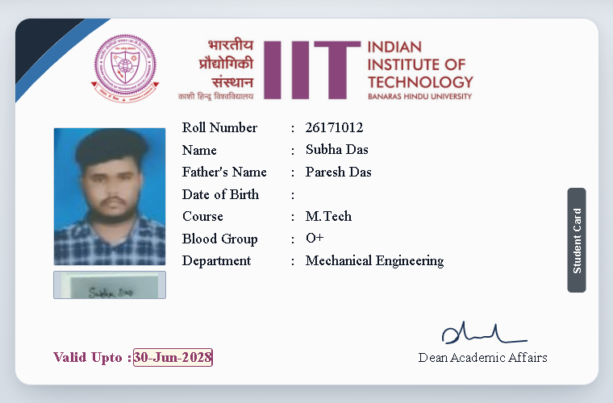

# IIT (BHU) Student Identity Card - Official Exact Replica

An exact, pixel-perfect, interactive digital replica of the official **Indian Institute of Technology (BHU) Varanasi** Student Identity Card, built using pure HTML, Vanilla CSS, and JavaScript.



## ✨ Features

- **Exact Physical ID-1 CR80 Proportions**: Standard physical card size (85.6 mm × 53.98 mm / 580px × 365px with 16px corner radii).
- **Official Master Branding**:
  - Official circular IIT (BHU) emblem.
  - Official typography banner (Hindi institution title, plum-colored bold **IIT** acronym, and bilingual English institution title).
- **Precise Corner Accent**: Custom dual-tone vector geometry with a dark navy corner wedge (`#1f2d3d`) and sky blue concave swoop (`#3572ac`).
- **Interactive Live Editing**:
  - Click any text field (Name, Roll No, Department, Blood Group, Course, Validity, etc.) to edit directly on the card (`contenteditable="true"`).
  - Hover or click on the photo box to upload a new student photo, or drag and drop an image file directly onto the photo box.
  - Upload or type custom student signatures.
- **Authentic Signatures & Seals**:
  - Student signature box with customizable text/image mode.
  - Dean of Academic Affairs signature in fluid blue ink.
  - Charcoal vertical side badge (`Student Card`).
- **Print & PVC Card Ready**:
  - Optimized `@media print` stylesheets.
  - One-click **Print / Save as PDF** button that hides all toolbars and aligns the card to exact PVC printing dimensions.
- **Fully Self-Contained**: All critical assets are embedded directly via clean base64 data URIs—runs offline with zero external dependencies.

## 🚀 Quick Start

Simply open `index.html` in any modern web browser (Chrome, Edge, Firefox, Safari).

```bash
# Clone the repository
git clone https://github.com/RohitGrandmaster/id-card.git

# Open in browser
cd id-card
start index.html
```

## 🛠️ Controls

- **🖨️ Print / Save as PDF**: Opens print dialog formatted specifically for standard ID-1 card scale.
- **📷 Change Photo**: Browse and select any profile photo from your device.
- **✍️ Upload Signature Image**: Replace the student signature with a scanned image or type directly.
- **🔄 Reset Original Data**: Restores default student card details.
